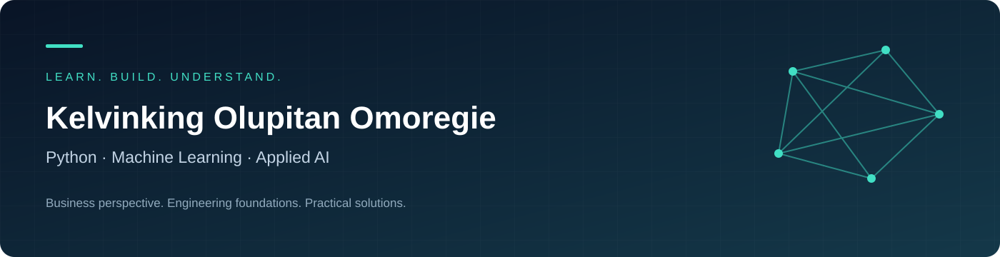
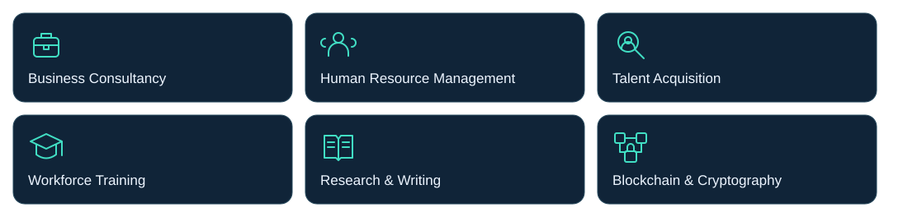

<b>PYTHON &nbsp; / &nbsp; MACHINE LEARNING &nbsp; / &nbsp; APPLIED AI</b>

Software &amp; Web Development · Chatbot Design · AI Automation · Technical Writing

<b>Business Consultancy · Human Resource Management · Talent Acquisition</b> 
Workforce Training · Research &amp; Writing · Blockchain &amp; Cryptography

<a href="#about">About</a> · <a href="#-knowedge-publishing--my-books">My Books</a> · <a href="#skills--technology-ecosystem">Skills &amp; Tools</a> · <a href="#technical-focus">Technical Focus</a> · <a href="#application-domains">Applications</a> · <a href="#engineering-principles">Engineering</a>

---

## About

I'm **Kelvinking Olupitan Omoregie**, a business consultant, technology strategist, author and founder of **KnowEdge Business Development Services Ltd**. I connect technology, business strategy and people development to turn ideas into practical solutions.

My work spans **Python, machine learning, software and web development, programming, AI-assisted development, chatbot design and AI automation**. My broader interests include **blockchain, cryptography, predictive analytics and AI evaluation**, alongside **business consultancy, human resource management, talent acquisition and workforce training**.

Through **research, writing and technical documentation**, I translate complex ideas into accessible knowledge—from product requirements and software guides to business resources and books.

I also lead **[KnowEdge Publishing](https://knowedgepublishing.com)**, my publishing platform for practical knowledge, professional development and business education. My books include the **AI Business Series**, exploring how entrepreneurs, professionals and organisations can apply AI across business operations, management, marketing, finance, customer experience and talent development.

This portfolio brings together my **code, technical experiments, research and project documentation**, reflecting my commitment to useful technology, clear communication and practical business value.

## 📚 KnowEdge Publishing & My Books

I founded **[KnowEdge Publishing](https://knowedgepublishing.com/)** to bring together my books, practical resources and learning experiences for entrepreneurs, professionals and organisations. My writing connects business strategy, technology and responsible AI adoption with everyday work.

### The AI-Powered Business Series

My **16-book series** explores AI across business operations, individual productivity, leadership, governance, marketing, finance, customer experience, people, innovation and business growth.

**Select a cover or title to explore the book.**

<table>
<tr>
<td width="25%" align="center" valign="top">
 
Book 1 
<a href="https://knowedgepublishing.com/books/the-ai-powered-business-operating-system"><b>The AI-Powered Business Operating System</b></a>
</td>
<td width="25%" align="center" valign="top">
 
Book 2 
<a href="https://knowedgepublishing.com/books/the-ai-powered-one-person-business"><b>The AI-Powered One-Person Business</b></a>
</td>
<td width="25%" align="center" valign="top">
 
Book 3 
<a href="https://knowedgepublishing.com/books/ai-agents-for-small-business"><b>AI Agents for Small Business</b></a>
</td>
<td width="25%" align="center" valign="top">
 
Book 4 
<a href="https://knowedgepublishing.com/books/the-ai-ready-manager"><b>The AI-Ready Manager</b></a>
</td>
</tr>
<tr>
<td width="25%" align="center" valign="top">
 
Book 5 
<a href="https://knowedgepublishing.com/books/the-ai-ready-professional"><b>The AI-Ready Professional</b></a>
</td>
<td width="25%" align="center" valign="top">
 
Book 6 
<a href="https://knowedgepublishing.com/books/the-ai-governance-playbook"><b>The AI Governance Playbook</b></a>
</td>
<td width="25%" align="center" valign="top">
 
Book 7 
<a href="https://knowedgepublishing.com/books/the-ai-powered-marketing-and-sales-engine"><b>The AI-Powered Marketing and Sales Engine</b></a>
</td>
<td width="25%" align="center" valign="top">
 
Book 8 
<a href="https://knowedgepublishing.com/books/the-ai-powered-finance-and-decision-engine"><b>The AI-Powered Finance and Decision Engine</b></a>
</td>
</tr>
<tr>
<td width="25%" align="center" valign="top">
 
Book 9 
<a href="https://knowedgepublishing.com/books/the-ai-powered-customer-experience-engine"><b>The AI-Powered Customer Experience Engine</b></a>
</td>
<td width="25%" align="center" valign="top">
 
Book 10 
<a href="https://knowedgepublishing.com/books/the-ai-powered-people-and-talent-engine"><b>The AI-Powered People and Talent Engine</b></a>
</td>
<td width="25%" align="center" valign="top">
 
Book 11 
<a href="https://knowedgepublishing.com/books/the-ai-powered-operations-and-supply-chain-engine"><b>The AI-Powered Operations and Supply Chain Engine</b></a>
</td>
<td width="25%" align="center" valign="top">
 
Book 12 
<a href="https://knowedgepublishing.com/books/the-ai-powered-innovation-and-product-development-engine"><b>The AI-Powered Innovation and Product Development Engine</b></a>
</td>
</tr>
<tr>
<td width="25%" align="center" valign="top">
 
Book 13 
<a href="https://knowedgepublishing.com/books/the-ai-powered-data-and-knowledge-engine"><b>The AI-Powered Data and Knowledge Engine</b></a>
</td>
<td width="25%" align="center" valign="top">
 
Book 14 
<a href="https://knowedgepublishing.com/books/the-ai-powered-cybersecurity-and-business-resilience-engine"><b>The AI-Powered Cybersecurity and Business Resilience Engine</b></a>
</td>
<td width="25%" align="center" valign="top">
 
Book 15 
<a href="https://knowedgepublishing.com/books/the-ai-strategy-and-transformation-playbook"><b>The AI Strategy and Transformation Playbook</b></a>
</td>
<td width="25%" align="center" valign="top">
 
Book 16 
<a href="https://knowedgepublishing.com/books/building-and-monetising-ai-powered-businesses"><b>Building and Monetising AI-Powered Businesses</b></a>
</td>
</tr>
</table>

<a href="https://knowedgepublishing.com/books"><b>📖 Explore All Books</b></a> &nbsp;·&nbsp;
<a href="https://knowedgepublishing.com/"><b>🌐 Visit KnowEdge Publishing</b></a>

## Professional & Business Skills

| Area | Focus |
| :--- | :--- |
| **Business Consultancy** | Business development, strategy and operational improvement |
| **Human Resource Management** | People processes, organisational capability and workforce planning |
| **Talent Acquisition** | Recruitment workflows, candidate assessment and talent matching |
| **Workforce Training** | Skills development, AI adoption and practical training resources |
| **Research & Writing** | Research synthesis, articles, reports and technical documentation |
| **Blockchain & Cryptography** | Distributed systems, digital assets and cryptographic concepts |

## Skills & Technology Ecosystem

### 🐍 Python & Machine Learning

Python · scikit-learn · TensorFlow · PyTorch · OpenCV · Anaconda

### 🌐 Web Development & Programming

HTML · CSS · JavaScript · TypeScript · React · Next.js · Node.js · PHP

### ⚙️ Python Web, APIs & Data

Django · Flask · FastAPI · MySQL · PostgreSQL · SQLite · Supabase

### ✨ Vibe Coding & AI-Assisted Development

### 🧩 CMS & Website Platforms

### ✍️ Documentation & Collaboration

Markdown · Notion · GitHub

This section maps the technology ecosystem around my areas of focus. Project READMEs document the tools used in each implementation.

## Technical focus

<table>
<tr>
<td width="50%" valign="top">

### 🐍 Python & Software
- Python applications and automation
- Data processing and analytical workflows
- Reusable functions and modular design
- Debugging, testing and code analysis

</td>
<td width="50%" valign="top">

### 🧠 Machine Learning
- Predictive modelling
- Regression and classification
- Feature preparation and selection
- Baselines, validation and error analysis

</td>
</tr>
<tr>
<td width="50%" valign="top">

### 📊 Data & Forecasting
- Exploratory data analysis
- Data quality and visualisation
- Time-series and weather forecasting
- Business performance insights

</td>
<td width="50%" valign="top">

### ⚙️ Applied AI
- AI-assisted software prototyping
- LLM applications and coding agents
- Code quality and model evaluation
- Practical business use cases

</td>
</tr>
<tr>
<td width="50%" valign="top">

### 💻 Software, Web & Programming
- Application design and programming
- Websites and web application workflows
- Business logic and software integrations
- Code organisation, review and documentation

</td>
<td width="50%" valign="top">

### 🤖 Chatbot Design & AI Automation
- Conversational flows and chatbot behaviour
- Prompt design and structured responses
- AI-assisted business workflows
- Automation requirements and exception handling

</td>
</tr>
<tr>
<td colspan="2" valign="top">

### ✍️ Writing & Technical Documentation
- Technical articles and explanatory writing
- Software requirements and product specifications
- User guides, tutorials and onboarding materials
- README files, setup instructions and project documentation
- Translating technical concepts for business audiences

</td>
</tr>
</table>

## Application domains

**Business Analytics** · **Forecasting** · **Web Applications** · **Chatbots** · **AI Automation** · **Decision Support** · **Technical Communication** · **AI Evaluation**

I am particularly interested in connecting technical work to clear requirements, measurable outcomes and useful explanations.

## Engineering principles

| Principle | What matters |
| :--- | :--- |
| **Correctness** | Implement the requirement and check boundary cases. |
| **Reproducibility** | Document dependencies, data preparation and execution steps. |
| **Evaluation** | Use appropriate baselines, metrics and validation methods. |
| **Clarity** | Keep code readable and explain assumptions and limitations. |
| **Practical value** | Connect technical decisions to the problem being solved. |

## Explore my work

Browse my [public repositories](https://github.com/Kelvinkingly?tab=repositories) for available code and documentation. Each project's README is the source for its implementation details, technology stack and current status.

---

<b>From business questions to computational solutions.</b> Kelvinking Olupitan Omoregie · Nigeria

